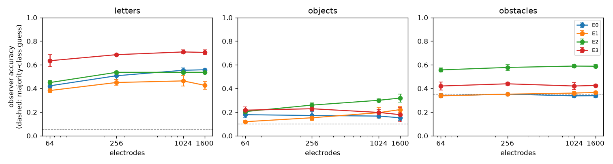

# phosphene-lab

An end-to-end sandbox for encoding and calibrating cortical visual prostheses.
Work in progress; see [PROJECT_SPEC.md](PROJECT_SPEC.md) for the plan.


*The demo app (`app/app.py`, 46 s, real screenshots of the running app; all patients are
simulated). First the viewer: one photo through the naive, edge, and scene encoders, then 1600
electrodes, 30% dead electrodes, 3 s of adaptation, and a sign in reading mode with the learned
encoder. Then the calibration game: the player is the patient, clicking where each flash
appears; here a few answers are clicked and then the virtual patient answers the rest. This
patient's map reached the accuracy of a full exhaustive pass (512 queries) after 111.*

## Quickstart

```bash
uv sync
uv run pytest
uv run python scripts/render_reference.py --quick   # writes results/phase0_reference.png
uv run python app/app.py                            # the demo, at http://127.0.0.1:7860
```

E3 in the demo needs the checkpoints from `scripts/train_e3.py` (not in git); without them the
demo offers E0-E2. E2 downloads its two pretrained networks (~115 MB) on first use.

## Results so far (Phases 2-4)

All numbers below come from files in `results/`, written by the scripts named. Accuracy is a
virtual observer's (mean ± std over 3 seeds); "majority" is always guessing the most common
test class.



**Benchmark** (`scripts/run_benchmark.py`, `results/benchmark_summary.csv`), 256 electrodes,
no dead electrodes, default patients:

| task (majority) | E0 naive | E1 edges | E2 scene | E3 learned |
|---|---|---|---|---|
| letters (0.054) | 0.51 ± 0.03 | 0.45 ± 0.02 | 0.54 ± 0.01 | **0.69 ± 0.00** |
| objects (0.10) | 0.17 ± 0.04 | 0.15 ± 0.03 | **0.26 ± 0.02** | 0.23 ± 0.02 |
| obstacles (0.353) | 0.35 ± 0.00 | 0.35 ± 0.00 | 0.58 ± 0.02 | **0.62 ± 0.03** |

- E3 (learned) reads letters best at every array size and uses about 3x less total current than
  E0, but it drives every electrode at a low level (some below threshold), so its "active
  electrodes" count is not comparable to the others.
- **E3 on obstacles took two fixes.** With plain reconstruction error, training collapsed to
  almost no stimulation (accuracy 0.33 ± 0.06, the majority guess): navigation targets are
  mostly black, so drawing nothing already scored well. Weighting lit and dark target pixels
  equally (`balanced_recon` in `configs/phase2_e3.yaml`) stopped the collapse but reached only
  0.44 ± 0.01, the same as an observer gets from the 48-px photo itself with no simulator
  (0.43, `scripts/obstacle_ceiling.py`, `results/obstacle_ceiling.csv`): obstacles are defined
  by depth, which a small CNN cannot learn from 1160 photos. Giving E3 the E2 scene as an
  extra input (`scene_input`; the observer gets 0.63 from that scene with no simulator) lifted
  it to 0.62 ± 0.03, ahead of E2 by about 1.4 standard
  deviations, and at or above E2 in all 14 obstacle conditions (largest margins with high
  patient variability, 0.60 vs 0.53, and 30% dead electrodes, 0.62 vs 0.57), using about 30%
  more current than E2.
- Accuracy changes little from 256 to 1600 electrodes, with 30% dead electrodes, or with patient
  variability, in this setup (see the dropout and variability figures). Part of the reason is
  the observer, which is retrained for every patient (see the calibration note below).
- Objects stay hard for every encoder (best: E2 at 1600 electrodes, 0.32 ± 0.04).

**Calibration** (`scripts/run_calibration.py`, `results/phase4_queries_to_target.csv`), 256
electrodes; the target is the error that one full exhaustive pass (2048 queries, ~171 clinic
minutes) reaches:

| patients | error | active needs | random needs |
|---|---|---|---|
| correlated | location | 32 queries (~3 min) | not reached in 2048 |
| correlated | threshold | 1088 queries (~91 min) | not reached in 2048 |
| independent | location | 1984 queries (~165 min) | not reached in 2048 |
| independent | threshold | 1248 queries (~104 min) | 1824 queries (~152 min) |

The large location win depends on most of the error being shared across the array (the
"correlated" assumption); when every electrode errs on its own, active calibration gains little
on location.

**How much must be shared?** (`configs/phase4_shared_sweep.yaml`,
`results/phase4_shared_sweep_queries_to_target.csv`): with total deviation held fixed, the
queries active calibration needs to match a full exhaustive pass on location fall from 1984
(nothing shared) to 1600, 704, 64, and 32 as the shared fraction rises through 0.25, 0.5, 0.75,
and 0.95; for thresholds they fall from 1248 to 864. Sharing pays off once about half of the
error is common to the array.

**What if the population guess is wrong?** (`configs/phase4_fit_prior.yaml`,
`results/phase4_fit_prior_queries_to_target.csv`): the same correlated patients, but the
calibrator assumes the Phase 1-3 population with no shared placement error. Plain active
calibration then needs 1792 queries (~149 min) to match a full exhaustive pass on location.
Refitting the location prior's hyperparameters to the patient's own reports every 50 queries
("active_fit") brings that back to 64 queries (~5 min), against 32 with the right prior. With
the right prior, refitting changes nothing that matters (32 queries either way; thresholds
1024 vs 1088). Location error after 256 queries, wrong prior: 0.40 ± 0.17 deg without
refitting, 0.15 ± 0.01 deg with it.

**Closing the loop** (`scripts/closed_loop.py`, `results/phase4_closed_loop_summary.csv`):

- With an observer retrained for each map (a fully adapted patient), task accuracy was the
  same, within noise, for the true map, the uncalibrated guess, and calibrated maps.
- With a fixed observer trained under the true map (a patient who has not adapted), the
  uncalibrated map costs letter accuracy and calibration recovers most of it: E2 0.41 ± 0.08
  uncalibrated, 0.44 ± 0.04 after 100 queries, 0.46 ± 0.06 after 1000, 0.46 ± 0.07 with the
  true map; E3 0.63 ± 0.05, 0.67 ± 0.03, 0.66 ± 0.04, 0.68 ± 0.03. These gaps are within about
  one standard deviation over 3 seeds, so they are suggestive, not conclusive. Objects and
  obstacles show no difference.
- **Pointing task** (`scripts/pointing_task.py`, `results/phase4_pointing_summary.csv`): E0
  shows a white dot, and the patient points at the brightness centroid of what they see; no
  observer is trained, so a wrong map cannot be learned around. Mean miss over 3 patients:
  0.48 ± 0.04 deg with the true map (the floor: a few hundred blurry phosphenes cannot draw a
  dot exactly), 0.88 ± 0.11 deg uncalibrated, 0.56 ± 0.10 deg after 32 active queries (~3
  min), and 0.55 ± 0.08 deg after 1000. So most of the pointing error from an uncalibrated map
  is removed within minutes, and more queries add little. About 30% of dots fall where this
  implant has no phosphenes and are not seen, with any map.
- SSIM to the intended picture improves clearly (E2 letters: 0.462 uncalibrated, 0.517 after 100
  queries, 0.533 with the true map; `results/phase4_closed_loop.csv`).

See [the Phase 4 note](docs/how-it-works/04-calibration.md).

**Compute budget:** E3 trains in about 4-7 min per task on a laptop CPU, calibration takes
under 2 min (about 3 min for the refitting comparison), and the closed loop about 12 min. The full benchmark took about 72 min of compute,
over the 1-hour budget, even after shrinking the observer and the letter set; it runs as
separate (task, seed) parts.

## How it works

- [Phase 0: the reference simulators](docs/how-it-works/00-setup.md)
- [Phase 1: the phosphene simulator](docs/how-it-works/01-simulator.md)
- [Phase 2: encoders](docs/how-it-works/02-encoders.md)
- [Phase 3: the benchmark](docs/how-it-works/03-benchmark.md)
- [Phase 4: fast calibration](docs/how-it-works/04-calibration.md)
- [Phase 5: the interactive demo](docs/how-it-works/05-demo.md)

## Assumptions

Every simplification in the simulator, in one sentence each:

- **Retinotopy:** the visual field maps onto V1 through the wedge-dipole model (Polimeni et al.,
  2006), which was fitted to macaque cortex, with human magnification constants from Horton &
  Hoyt (1991), so the map is a cross-species approximation.
- **Two hemispheres, one frame:** both hemispheres use the same map mirrored left-right, and we
  ignore V1's real folding and orientation in the skull.
- **Implant location:** default arrays cover a cortical rectangle spanning roughly 1-8 deg of
  eccentricity, which leaves the central ~1 deg and the regions straight above and below
  fixation without phosphenes.
- **Thread arrays:** each insertion site counts as one electrode; contacts along a thread's depth
  are not modeled.
- **Phosphene shape:** every phosphene is a round Gaussian blob; real phosphenes can be
  elongated, colored, or oddly shaped.
- **Phosphene size:** current spreads over a cortical disk of radius sqrt(I / 675 uA/mm^2), as in
  dynaphos, and the disk is converted to degrees by the cortical magnification at that location.
- **Pixel floor:** phosphenes smaller than a pixel are drawn with a half-pixel blur so they stay
  visible as dots, which makes small central phosphenes look larger and brighter than a
  sub-pixel-accurate renderer would.
- **Brightness:** brightness rises along a sigmoid around each electrode's threshold and does not
  model pulse width or frequency.
- **Merging:** overlapping phosphenes add up and then saturate smoothly, which is a rendering
  choice rather than a model of how the brain combines them.
- **Adaptation:** repeated stimulation dims a phosphene through a single leaky charge trace
  (time constant 1 s by default); real adaptation has several time scales.
- **Power budget:** limits are a per-electrode current cap and a maximum number of
  simultaneously active electrodes, not a model of charge density or tissue safety.
- **Virtual patients:** patient differences are random draws (position error, log-normal
  thresholds and sizes, dead electrodes) with made-up but plausible spreads, not fits to
  patient data.
- **Patient responses:** "did you see it?" answers follow a cumulative-normal curve with random
  lapses, and pointing answers add round Gaussian noise; real patients also show biases.

Encoders and tasks (Phase 2):

- **Image placement:** every encoder stretches the camera image over the smallest box that
  contains the patient's working phosphenes, so the whole image lands where the implant can
  draw; the uncovered meridian strip still cuts through the middle of a centered letter.
- **Fixed pulse amplitude:** E0 and E1 switch electrodes between off and a fixed 60 uA, and E2
  scales up to 60 uA, rather than tuning current to each electrode's threshold.
- **Scene networks:** E2 uses Depth Anything V2 Small (relative depth, so "near" means near for
  that image) and SegFormer-B0 trained on ADE20K photos, both run at reduced resolution on CPU.
- **Obstacle labels:** an NYU frame's label is the left, center, or right third whose lower
  two thirds are at least 15% nearer than 1.5 m (the most blocked third wins), otherwise
  "none"; this is a rule on the depth map, not a human annotation.
- **Object subset:** the object task is 10 COCO categories that are most often the largest
  object in a val2017 image, 70 images each, cropped to that object, so it is small and easier
  than full scene recognition.
- **Learned encoder inputs:** E3 shrinks images so the long side is at most 48 px, and it is
  trained only on 256- and 1024-electrode grids with default patients.
- **E3 obstacle loss:** for navigation only, E3's picture-matching error weights lit and dark
  target pixels equally, because plain error on mostly black targets taught it to draw nothing.
- **E3 obstacle input:** the navigation E3 also reads E2's depth-based scene, so it inherits
  the pretrained depth network's mistakes and is a learned layer on top of E2, not an
  independent alternative to it.

Evaluation (Phase 3):

- **Virtual observer:** task accuracy comes from a small CNN trained on each encoder's percepts,
  which measures how much task information survives but not how a person would learn to read
  phosphenes.
- **Charge proxy:** "total current per frame" sums the currents of active electrodes and stands
  in for charge, assuming every electrode fires the same pulse train.
- **Known map during benchmarking:** Phase 3 encoders use each patient's true phosphene map, as
  if calibration were perfect; Phase 4 removes that assumption.

Calibration (Phase 4):

- **Population knowledge:** calibration knows the population's psychometric slope, lapse rate,
  pointing noise, and how much patients vary, but nothing about the specific patient.
- **Query cost:** every query is one stimulation plus a pointing answer ("nothing" counts as an
  answer) and is assumed to take 5 s of clinic time.
- **Correlated deviations:** the Phase 4 patients deviate from the plan mostly through how the
  whole array landed (a shift and a small rotation per hemisphere) and a smooth excitability
  field over cortex; the sizes of these effects are plausible guesses, not measurements.
- **Refitting the location prior:** "active_fit" re-estimates only the location model's four
  spreads (shift, smooth field, its length scale, per-electrode jitter) under a weak prior
  centered on 1 mm (5 mm for the length scale); the threshold model's population values stay
  fixed.
- **Pointing:** the simulated patient points exactly at the brightness centroid of the
  percept, and "correct" means where the same image lands when placed with the true map, so
  the task measures map errors only, not motor noise or how a person judges a blob's center.

Demo (Phase 5):

- **Viewer patient:** the viewer shows a default virtual patient and encodes with that
  patient's true phosphene map, as if calibration were perfect; the game covers the rest.
- **Percepts on a screen:** a monitor shows the simulator's grayscale blobs, which is not what a
  phosphene looks like to an implant user, only where and how bright the model says it is.
- **The player as patient:** a sighted player sees the simulated flash on a screen and clicks
  it, so their answers are far more precise than real pointing; the calibrator still assumes
  the population's 0.5 deg pointing noise.
- **Game size:** the game uses a 64-electrode array so that it can be played by hand; Phase 4
  ran 256 electrodes.

## Acknowledgements

Reference percepts use [pulse2percept](https://github.com/pulse2percept/pulse2percept) (BSD) and
[dynaphos](https://github.com/neuralcodinglab/dynaphos) (GPL-3.0; default parameters copied into
`configs/dynaphos_params.yaml`).
